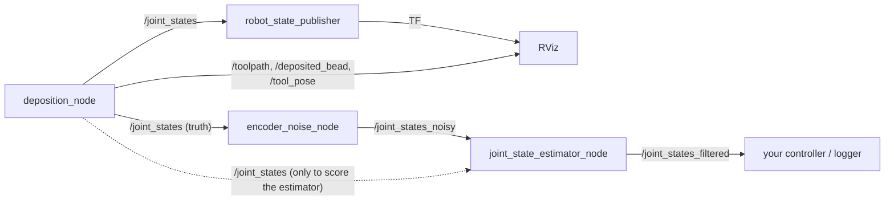

# Deposition Kinematics ROS 2

[](https://github.com/OmobolajiOgunleye/deposition-kinematics-ros2/actions/workflows/tests.yml)

A ROS 2 (Python) simulation of **layer-by-layer metal deposition** (WAAM / DED style) on a planar 2R or 3R arm
with a vertical Z axis. It wraps my [Deposition-Kinematics](https://github.com/OmobolajiOgunleye/Deposition-Kinematics-)
toolkit (transforms, forward and inverse kinematics, layered toolpaths) in ROS 2 nodes, and adds a **Kalman-filter
joint-state estimator** from my [Polisher-State-Estimator](https://github.com/OmobolajiOgunleye/Polisher-State-Estimator-)
project, so the simulated encoders are noisy and the estimator has to recover clean joint angles and velocities.

> **Scope.** This is a simulation. There is no real robot, no hardware driver and no MoveIt in this repo.
> It is a learning project for ROS 2 fundamentals: nodes, topics, URDF, TF, launch files and RViz.
> Developed against ROS 2 **Jazzy**. It uses no Jazzy-specific APIs, so Humble should work too (not yet tested).

## What it does



1. `deposition_node` builds a toolpath (circle wall or spiral fill), solves the inverse kinematics along it at a
   constant deposition speed, and plays the result as joint states. Between layers the Z axis lifts by one layer
   height while the joints move smoothly to the next start point.
2. `robot_state_publisher` turns the joint states into TF using the URDF in `urdf/`, so RViz shows the arm,
   the planned toolpath and the bead as it is laid down.
3. `encoder_noise_node` simulates cheap encoders (Gaussian angle noise, no velocity).
4. `joint_state_estimator_node` runs one two-state (angle, velocity) Kalman filter per joint and publishes
   `/joint_states_filtered`.

## Quick start

Requires ROS 2 Jazzy (desktop install, for RViz) on Ubuntu 24.04.

```bash
source /opt/ros/jazzy/setup.bash
mkdir -p ~/ros2_ws/src && cd ~/ros2_ws/src
git clone https://github.com/OmobolajiOgunleye/deposition-kinematics-ros2.git
cd ~/ros2_ws
colcon build --packages-select deposition_kinematics_ros2
source install/setup.bash

ros2 launch deposition_kinematics_ros2 demo.launch.py
```

Other cases:

```bash
# spiral fill with a 2R arm
ros2 launch deposition_kinematics_ros2 demo.launch.py path:=spiral dof:=2 tool:=fixed

# quick look: 3 layers, faster
ros2 launch deposition_kinematics_ros2 demo.launch.py layers:=3 speed:=40.0

# no GUI (for a remote machine or CI)
ros2 launch deposition_kinematics_ros2 demo.launch.py rviz:=false
```

In another terminal:

```bash
ros2 topic echo /deposition/state            # APPROACH, DEPOSITING, LAYER_CHANGE, RETURN_HOME, DONE
ros2 topic echo /joint_states_filtered       # Kalman estimate (angle and velocity)
ros2 topic hz /joint_states
```

### Launch arguments

| Argument | Default | Meaning |
|---|---|---|
| `path` | `circle` | `circle` (thin wall) or `spiral` (filled disc) |
| `dof` | `3` | `2` or `3` revolute joints |
| `tool` | `tangent` | 3R tool direction: `tangent` (follows the path) or `fixed` |
| `speed` | `25.0` | deposition travel speed, mm/s (the original toolkit demo used 8) |
| `layers` | `0` | number of layers; `0` keeps the toolkit default (16 circle, 5 spiral) |
| `loop` | `false` | restart after returning home |
| `rviz` | `true` | open RViz |
| `estimator` | `true` | run the noisy encoders and the Kalman estimator |
| `angle_noise_std` | `0.002` | simulated encoder noise, rad |
| `process_noise_q` | `0.1` | Kalman process noise q |

## Topics

| Topic | Type | Published by |
|---|---|---|
| `/joint_states` | `sensor_msgs/JointState` | `deposition_node` (`joint1..N` in rad, `z_lift` in m, with velocities) |
| `/tool_pose` | `geometry_msgs/PoseStamped` | `deposition_node` (tool tip in the `world` frame, m) |
| `/toolpath` | `nav_msgs/Path` | `deposition_node` (all layers, republished at 1 Hz) |
| `/deposited_bead` | `visualization_msgs/Marker` | `deposition_node` (one line strip per layer) |
| `/deposition/state` | `std_msgs/String` | `deposition_node` |
| `/deposition/progress` | `std_msgs/Float32` | `deposition_node` (0 to 1) |
| `/joint_states_noisy` | `sensor_msgs/JointState` | `encoder_noise_node` |
| `/joint_states_filtered` | `sensor_msgs/JointState` | `joint_state_estimator_node` |

## State estimation result


Circle wall, 3R arm, 3 layers, 25 mm/s, encoder noise σ = 0.002 rad (about 0.11°), 50 Hz.
Velocity RMSE over all joints while the arm is moving:

| | RMSE (rad/s) |
|---|---|
| Finite difference of the noisy angle | about 0.143 |
| Kalman filter | about 0.046 to 0.049 |

The filter is about 3 times closer to the true velocity. Two caveats: the noise is simulated (white Gaussian, which
real encoders are not), and I chose `process_noise_q = 0.1` by sweeping q on this same trajectory, so the number is
tuned rather than independent. For real encoders, measure R first (see the tuning guide in
[Polisher-State-Estimator](https://github.com/OmobolajiOgunleye/Polisher-State-Estimator-)).

The figure is reproducible offline with `python tools/make_figure.py` (needs matplotlib). The ROS nodes log the
same comparison every 10 seconds.

## Design notes

* **Layer changes.** In the original toolkit the 3R wrist unwinds a full turn between layers, which is a 2π jump in
  the joint angle. Here every layer change is a smooth cubic-ease move over a few seconds, so the joint states are
  continuous and an estimator never sees a step.
* **Z axis.** Modelled as a prismatic joint on a lifting column under the arm. The tool frame `tool0` sits at the
  height of the Z axis, so its TF z equals the toolpath z.
* **URDF vs Python.** The link lengths in `urdf/planar_*r.urdf` match `ARM_2R` and `ARM_3R` in
  `trajectory.py` (200, 150, 60 mm). Change both together. I cross-checked the TF of `tool0` against the forward
  kinematics of the published joint angles: they agree to within about 0.5 mm (the remainder is TF time interpolation).
* **Only the Python kinematics are authoritative.** The URDF is for visualisation and TF.

## Tests

```bash
python -m pytest -q                     # 65 unit tests, no ROS needed
python -m pytest tests/test_ros_nodes.py -q   # 2 integration tests that run the real nodes (needs ROS sourced)
```

* `tests/test_kinematics.py`: the original toolkit's tests (transforms, FK, IK, Jacobian, toolpaths).
* `tests/test_trajectory.py`: continuity, tool follows the toolpath, commanded speed, one layer height per layer, starts and ends at rest.
* `tests/test_estimation.py`: the Kalman bank beats finite differences, restarts after gaps, ignores old time stamps.
* `tests/test_ros_nodes.py`: topics, message contents, tool pose equals forward kinematics, and the full noise-to-estimator pipeline.

## Repository layout

```
deposition_kinematics_ros2/
  kinematics.py, toolpaths.py, deposition.py   from Deposition-Kinematics (imports adjusted)
  kalman_filter.py                             from Polisher-State-Estimator
  trajectory.py                                toolpath -> smooth joint trajectory (no ROS)
  estimation.py                                per-joint Kalman bank and RMSE scoring (no ROS)
  deposition_node.py, encoder_noise_node.py, joint_state_estimator_node.py
launch/demo.launch.py     urdf/planar_{2,3}r.urdf     rviz/deposition.rviz
tests/                    tools/make_figure.py        docs/joint_estimation.png
```

## Possible next steps

* Replace the simulated encoders with a real signal source (an ESP32 publishing angles over micro-ROS, for example).
* Drive the arm through `ros2_control` instead of publishing joint states directly.
* Move from one planar arm to two arms sharing a workcell, with MoveIt 2 for motion planning.
* Add a point-cloud or camera topic and fuse it with the joint estimate.

## License

MIT. See `LICENSE`.
